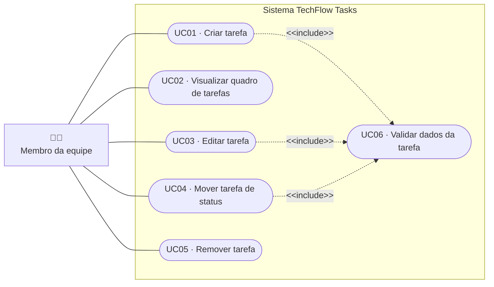

# Diagrama de Casos de Uso (UML)

O sistema tem um ator principal, o **Membro da equipe**, que gerencia as tarefas pelo
navegador. A validação dos dados é um caso de uso incluído (`<<include>>`) sempre que uma
tarefa é criada, editada ou movida.

> O Mermaid não tem um tipo próprio para casos de uso; a notação UML é representada com
> ator, elipses (casos de uso) e a fronteira do sistema.

## Descrição dos casos de uso

| ID | Caso de uso | Ator | Fluxo principal | Rota |
|---|---|---|---|---|
| UC01 | Criar tarefa | Membro da equipe | Preenche título (obrigatório) e descrição; o sistema valida e salva com status **A Fazer** | `POST /tarefas` |
| UC02 | Visualizar quadro | Membro da equipe | Abre a página inicial e vê as tarefas ativas separadas em 3 colunas, com contador | `GET /` |
| UC03 | Editar tarefa | Membro da equipe | Altera título, descrição e status; o sistema valida e salva | `GET/POST /tarefas/<id>/editar` |
| UC04 | Mover tarefa | Membro da equipe | Clica em **Avançar** ou **Voltar** no cartão; o status muda para a coluna vizinha | `POST /tarefas/<id>/status` |
| UC05 | Remover tarefa | Membro da equipe | Clica em **Remover** e confirma; a tarefa some do quadro (exclusão lógica) | `POST /tarefas/<id>/remover` |
| UC06 | Validar dados | — (incluído) | Título não vazio, até 100 caracteres, status entre os 3 permitidos | `Tarefa.validar()` |

## Regras de negócio

- **RN01:** o título é obrigatório e tem no máximo 100 caracteres.
- **RN02:** o status deve ser `A Fazer`, `Em Progresso` ou `Concluído`.
- **RN03:** toda tarefa nova começa em `A Fazer`.
- **RN04:** a remoção é lógica: o registro fica no banco com a data em `excluida_em` e
  deixa de aparecer no quadro.
- **RN05:** cada tarefa é exibida com um código legível no formato `TF-0001`.

## Fluxos alternativos

- **UC01/UC03 – dados inválidos:** o sistema não grava e mostra as mensagens de erro.
- **UC03/UC04/UC05 – tarefa inexistente ou removida:** o sistema responde **404**.
