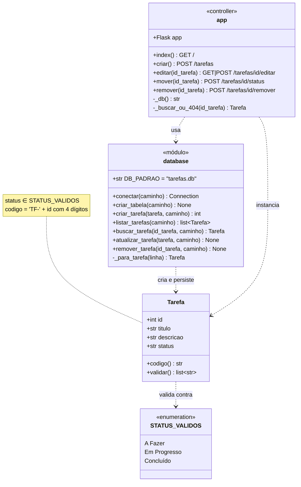
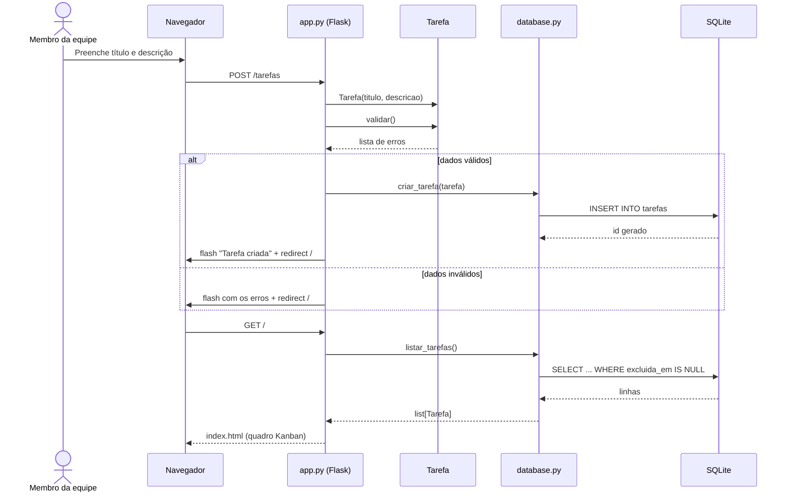

# Diagrama de Classes (UML)

O sistema segue uma separação em três camadas:

- **Modelo** (`src/models.py`): a classe `Tarefa` e suas regras de validação.
- **Persistência** (`src/database.py`): funções de acesso ao SQLite.
- **Controle/Visão** (`src/app.py` + `templates/`): rotas Flask que recebem as requisições
  e renderizam as páginas.

Como `database.py` e `app.py` são módulos Python (funções, não classes), eles aparecem
com os estereótipos `<<módulo>>` e `<<controller>>`.

## Responsabilidades

| Elemento | Responsabilidade |
|---|---|
| `Tarefa` | Guardar os dados de uma tarefa, gerar o código `TF-0000` e validar título/status |
| `STATUS_VALIDOS` | Lista fixa das colunas do Kanban |
| `database` | Abrir conexão, criar tabela e executar o CRUD (com exclusão lógica) |
| `app` | Receber as requisições HTTP, chamar validação/banco e renderizar os templates |

## Diagrama de sequência: criar tarefa

Mostra como as camadas conversam quando o usuário envia o formulário de nova tarefa.

