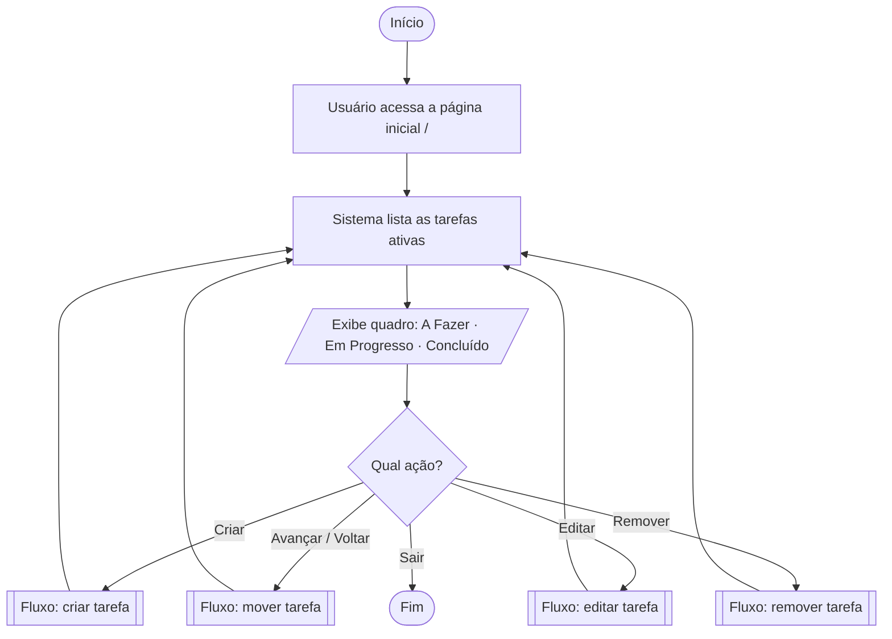
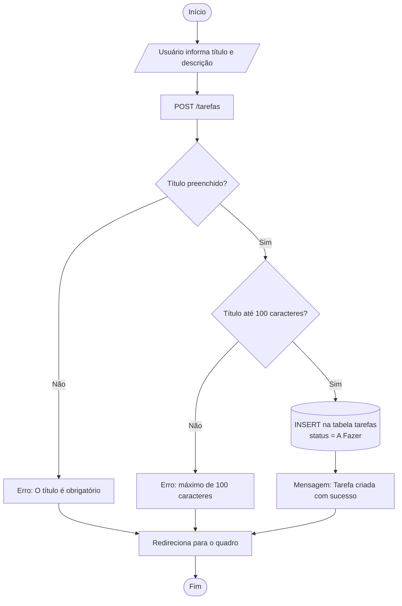
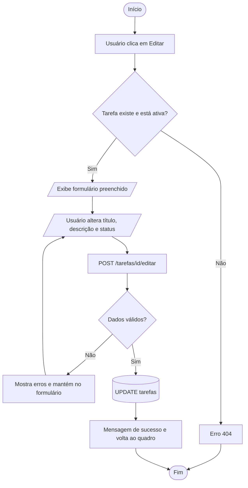
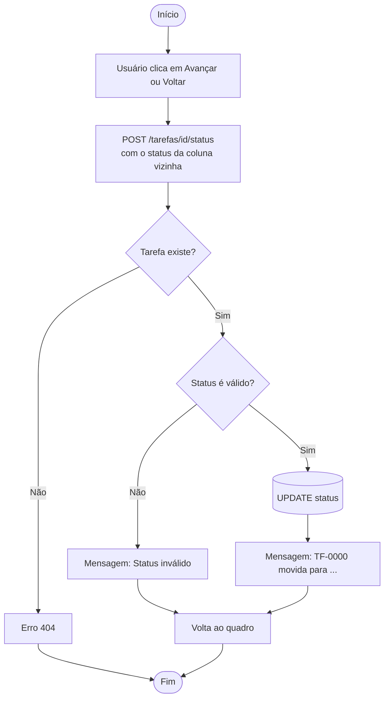
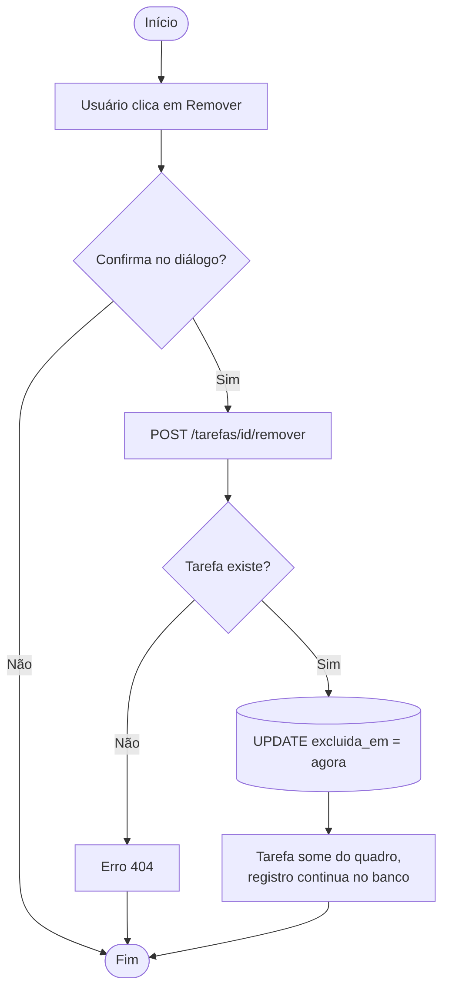
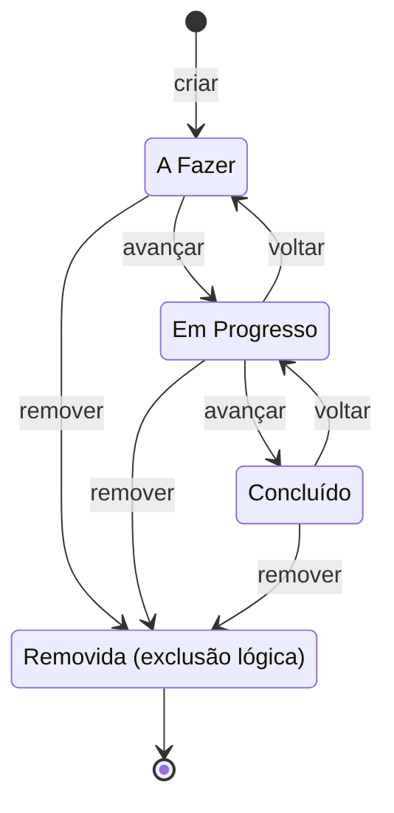
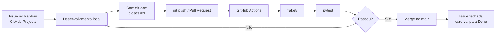

# Fluxogramas do Sistema

## 1. Fluxo geral de navegação

Do acesso ao sistema até cada operação disponível no quadro.

## 2. Criar tarefa

## 3. Editar tarefa

## 4. Mover tarefa (Avançar / Voltar)

## 5. Remover tarefa (exclusão lógica)

## 6. Ciclo de vida da tarefa (estados)

> Pela tela de edição também é possível trocar o status diretamente para qualquer coluna.

## 7. Fluxo de desenvolvimento e CI

Como uma mudança sai do Kanban e chega à branch `main`.

