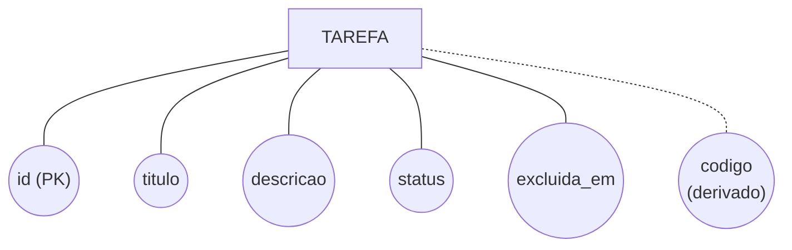
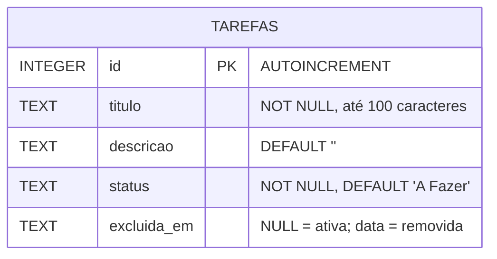
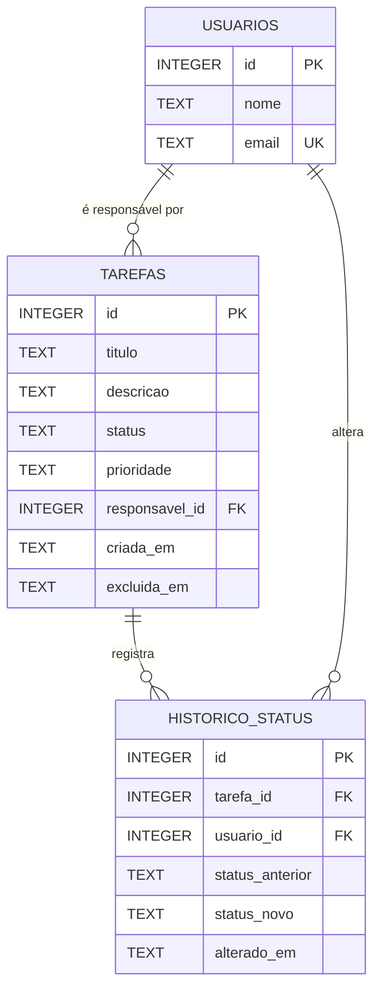

# Modelagem do Banco de Dados (MER e DER)

O banco é um arquivo **SQLite** (`tarefas.db`) criado automaticamente por
`criar_tabela()` em `src/database.py`. A versão atual tem uma única entidade, `TAREFA`.

## 1. MER: Modelo Entidade-Relacionamento (conceitual)

Notação de Peter Chen: retângulo = entidade, elipse = atributo,
**PK** = identificador.



- `codigo` é um **atributo derivado**: não é gravado no banco, é calculado a partir do `id`
  (`TF-0001`).
- `status` é um atributo com **domínio restrito**: `A Fazer`, `Em Progresso` ou `Concluído`.
- `excluida_em` registra a **exclusão lógica** (vazio = tarefa ativa).

## 2. DER: Diagrama Entidade-Relacionamento (lógico/físico)

Notação pé de galinha (Crow's Foot), com os tipos do SQLite.



## 3. Dicionário de dados

| Coluna | Tipo | Nulo? | Padrão | Restrição / regra |
|---|---|---|---|---|
| `id` | INTEGER | Não | auto | Chave primária, `AUTOINCREMENT` |
| `titulo` | TEXT | Não | — | Obrigatório, máx. 100 caracteres (validado em `Tarefa.validar()`) |
| `descricao` | TEXT | Sim | `''` | Texto livre |
| `status` | TEXT | Não | `'A Fazer'` | `A Fazer`, `Em Progresso` ou `Concluído` (validado na aplicação) |
| `excluida_em` | TEXT | Sim | `NULL` | Data/hora da exclusão lógica (`datetime('now')`) |

## 4. Script SQL (DDL)

```sql
CREATE TABLE IF NOT EXISTS tarefas (
    id          INTEGER PRIMARY KEY AUTOINCREMENT,
    titulo      TEXT NOT NULL,
    descricao   TEXT DEFAULT '',
    status      TEXT NOT NULL DEFAULT 'A Fazer',
    excluida_em TEXT DEFAULT NULL
);
```

## 5. Consultas usadas pelo sistema

| Operação | SQL |
|---|---|
| Criar | `INSERT INTO tarefas (titulo, descricao, status) VALUES (?, ?, ?)` |
| Listar ativas | `SELECT * FROM tarefas WHERE excluida_em IS NULL ORDER BY id DESC` |
| Buscar por id | `SELECT * FROM tarefas WHERE id = ? AND excluida_em IS NULL` |
| Atualizar / mover | `UPDATE tarefas SET titulo = ?, descricao = ?, status = ? WHERE id = ?` |
| Remover (lógica) | `UPDATE tarefas SET excluida_em = datetime('now') WHERE id = ?` |

## 6. Evolução proposta (fora do escopo atual)

Para atender ao objetivo de *monitorar o desempenho da equipe*, uma próxima versão poderia
separar usuários e o histórico de mudanças de status. Este modelo **ainda não está
implementado**; serve como planejamento.


